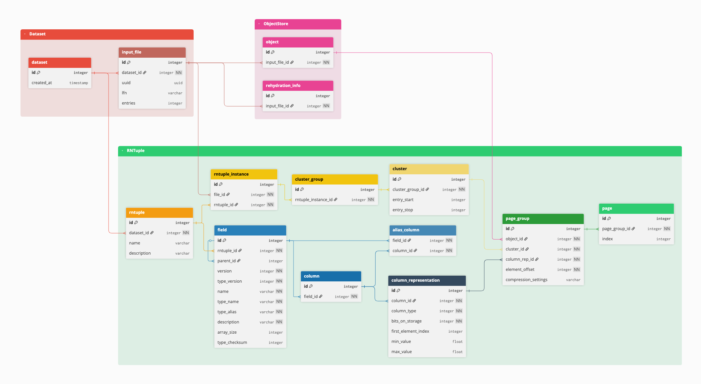

# rhydrator

[![Actions Status][actions-badge]][actions-link]
[![Documentation Status][rtd-badge]][rtd-link]

[![PyPI version][pypi-version]][pypi-link]
[![Conda-Forge][conda-badge]][conda-link]
[![PyPI platforms][pypi-platforms]][pypi-link]

[![GitHub Discussion][github-discussions-badge]][github-discussions-link]

[![Coverage][coverage-badge]][coverage-link]

<!-- SPHINX-START -->

<!-- prettier-ignore-start -->
[actions-badge]:            https://github.com/robjectifier/rhydrator/workflows/CI/badge.svg
[actions-link]:             https://github.com/robjectifier/rhydrator/actions
[conda-badge]:              https://img.shields.io/conda/vn/conda-forge/rhydrator
[conda-link]:               https://github.com/conda-forge/rhydrator-feedstock
[github-discussions-badge]: https://img.shields.io/static/v1?label=Discussions&message=Ask&color=blue&logo=github
[github-discussions-link]:  https://github.com/robjectifier/rhydrator/discussions
[pypi-link]:                https://pypi.org/project/rhydrator/
[pypi-platforms]:           https://img.shields.io/pypi/pyversions/rhydrator
[pypi-version]:             https://img.shields.io/pypi/v/rhydrator
[rtd-badge]:                https://readthedocs.org/projects/rhydrator/badge/?version=latest
[rtd-link]:                 https://rhydrator.readthedocs.io/en/latest/?badge=latest
[coverage-badge]:           https://codecov.io/github/robjectifier/rhydrator/branch/main/graph/badge.svg
[coverage-link]:            https://codecov.io/github/robjectifier/rhydrator

<!-- prettier-ignore-end -->

RHydrator is a Python library for (de)hydrating ROOT RNTuple files and storing
the metadata in a relational database. The metadata is organized as shown:



## Running the tests

```sh
git clone https://github.com/robjectifier/rhydrator.git
cd rhydrator
git submodule update --init reference/root-io-spec
uv run pytest
```

The submodule `reference/root-io-spec` holds the small RNTuple files most tests
read. Never initialize it with `--recursive`: root-io-spec's own submodule is
ROOT's source tree (1.5 GB). Without the submodule, those tests fail.

Other tests read scikit-hep-testdata's RNTuple files, which the package
downloads on first use and caches. When it can't, those tests are skipped.

### Large files (optional)

A few tests check rhydrator at CMS scale, on three large RNTuple files. These
files are not distributed with rhydrator and cannot be downloaded from it;
maintainers who have them keep their own local copy. Without them, those tests
are skipped and nothing else changes. CI never runs them.

To run them, put the three files in one directory, under exactly these names,
and set `RHYDRATOR_LARGE_FILES` to that directory's absolute path:

| File                                                        | What                                 | Size (bytes)  |
| ----------------------------------------------------------- | ------------------------------------ | ------------- |
| `DYJetsToLL_RunIIAutumn18NanoAODv7_RNTuple_named_zstd.root` | CMS NanoAOD, written by ROOT 6.40.04 | 1,891,767,386 |
| `initialconversion_rntuple_mini24_lzma4_buffer4.rntpl`      | CMS MiniAOD, written by ROOT 6.36    | 3,391,001,326 |
| `initialconversion_rntuple_minisim24_lzma4_buffer4.rntpl`   | CMS MiniSim, written by ROOT 6.36    | 5,999,969,177 |

```sh
RHYDRATOR_LARGE_FILES=/path/to/large-files uv run pytest
```

- **Unset or empty:** the large-file tests are skipped; pytest's summary names
  the variable as the reason.
- **Set:** each of the three files must be in that directory at the size above.
  A missing file, or one of another size, fails its tests instead of skipping
  them. Other files in the directory are ignored.
